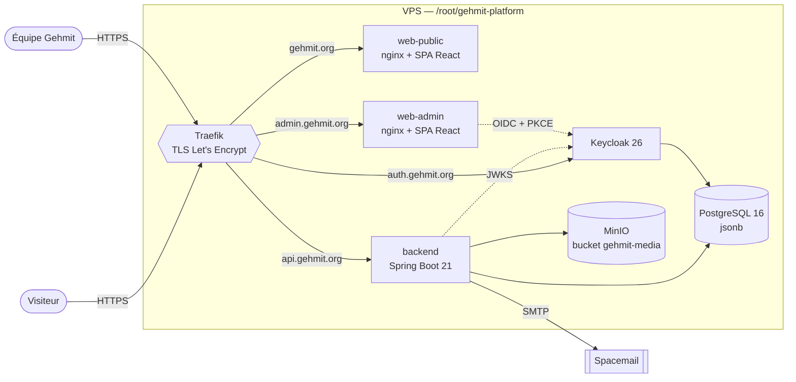
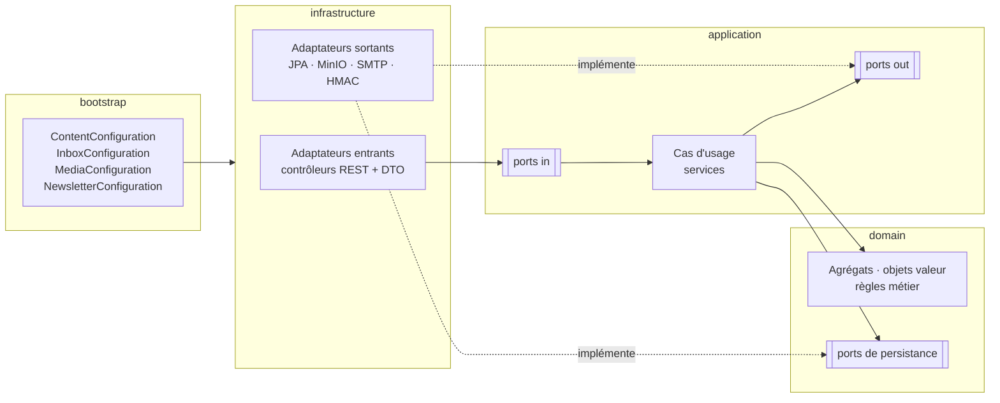
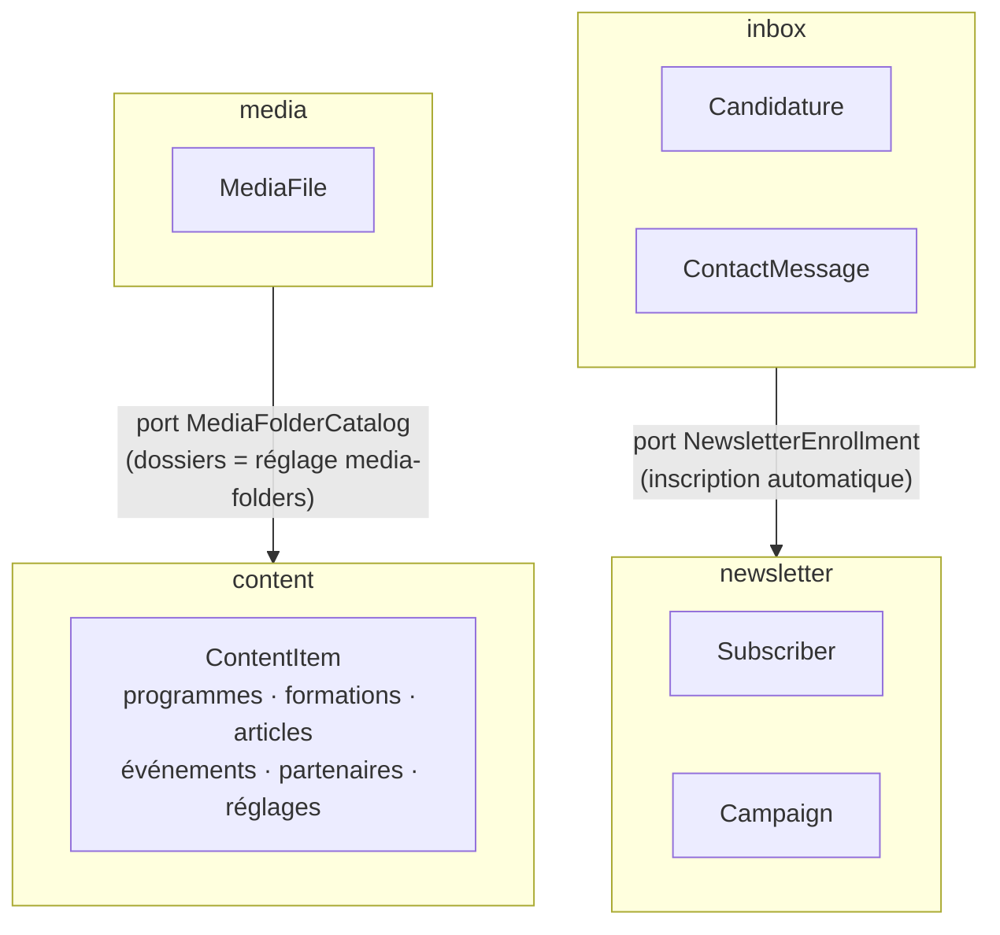
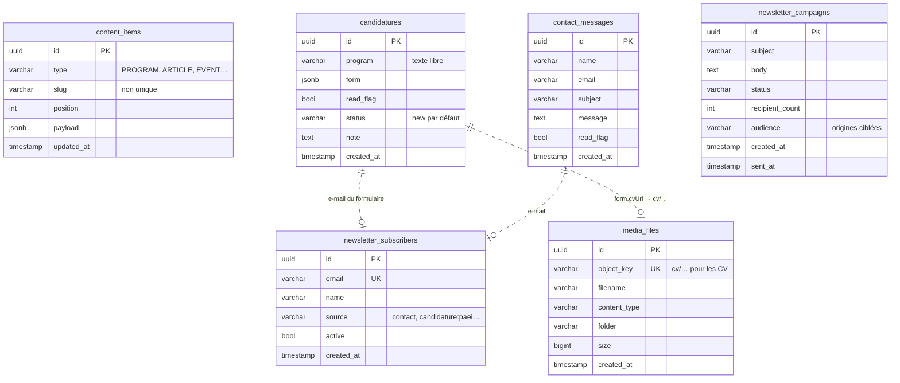
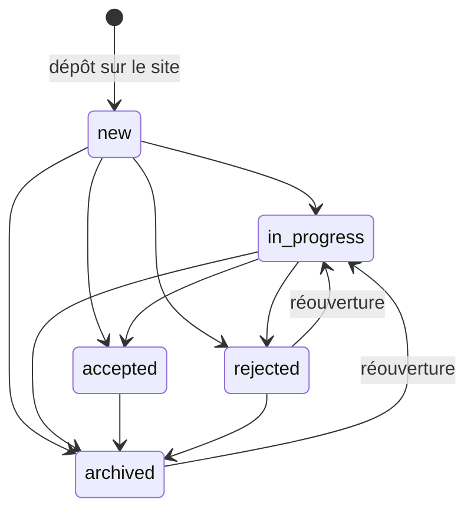
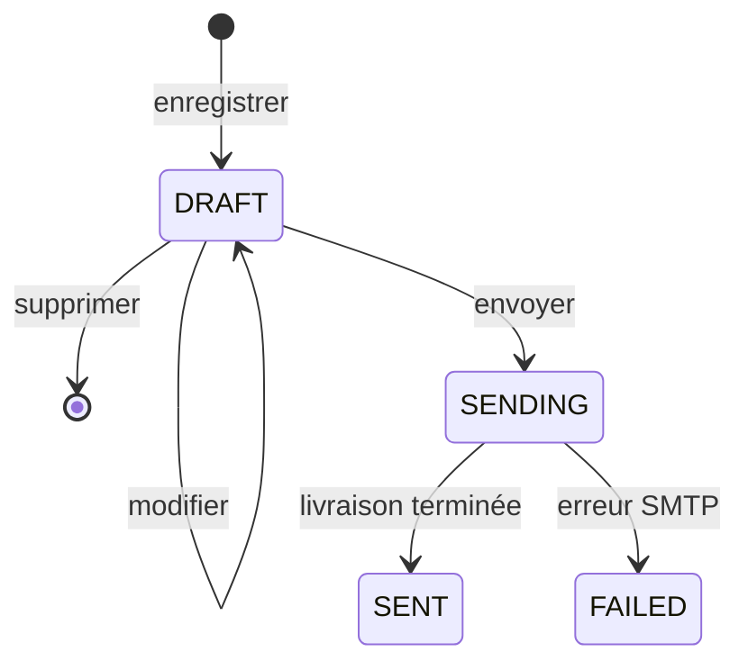
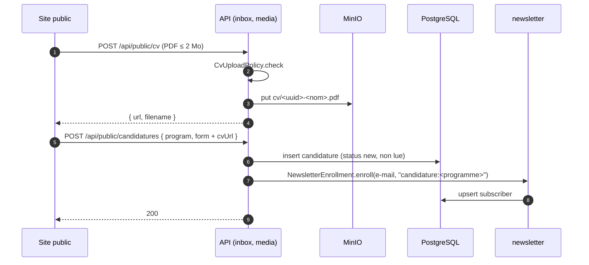
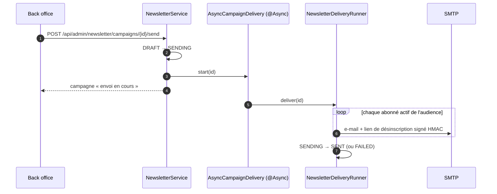

# API Gehmit — architecture en diagrammes et revue fonctionnelle

État au 9 octobre 2026 (commit `bdd594a`). Complète le [README](../README.md),
qui reste la référence des conventions.

## 1. Vue d'ensemble du déploiement

Un seul VPS (partagé avec LesCracks), Traefik en frontal ; images construites
par GitHub Actions et tirées de Docker Hub.

## 2. L'hexagone : modules et sens des dépendances

Le compilateur garantit le sens `domain ← application ← infrastructure ← bootstrap` :
le domaine n'a aucune dépendance de production.

## 3. Contextes délimités et leurs deux liaisons

## 4. Modèle de données

`ddl-auto=update` : ce schéma suit les entités JPA. Le contenu éditorial est
volontairement générique (une table, un `payload` jsonb par type).

Les liens en pointillés ne sont pas des clés étrangères : ils passent par
l'e-mail ou par une URL stockée dans le jsonb.

## 5. Cycles de vie

### Candidature (règles dans `CandidatureStatus`)

### Campagne newsletter (règles dans `Campaign`)

### Article (règles dans `Article`)

`status` vaut `draft` ou `published` ; un article sans statut est publié
(contenu historique). Aucune publication programmée : `publishedAt` ne sert
qu'au tri.

## 6. Deux parcours de bout en bout

### Candidature avec CV

### Envoi d'une campagne

## 7. Carte de l'API

| Contexte | Public (`/api/public`) | Administration (`/api/admin`, rôle `admin`) |
|---|---|---|
| content | `GET /content`, `GET /articles/{slug}` | `GET /content`, `GET·POST /content/{type}`, `PUT·DELETE /content/{id}` |
| inbox | `POST /contact`, `POST /candidatures` | candidatures : liste, `summary`, `PATCH`, `DELETE` · messages : liste, `summary`, lu, `PATCH`, `DELETE` · `GET /inbox/activity` |
| media | `POST /cv`, `GET /media/{*key}?w=` | liste, dossiers (CRUD), envoi, suppression, `GET /media/cv/{*key}` |
| newsletter | `POST /newsletter/subscribe`, `POST /newsletter/unsubscribe`, `GET /newsletter/unsubscribe/{token}` | abonnés (liste, suppression), campagnes (CRUD brouillon, envoi), `activity`, `preview`, `send` direct |

Sécurité : JWT Keycloak (rôle de realm `admin`), sans session, CORS limité aux
deux sites ; toute autre route est refusée (`denyAll`).

## 8. Revue fonctionnelle

### Ce qui est solide

- **Frontières nettes** : quatre contextes, deux liaisons explicites par port,
  câblage lisible en un seul endroit (`bootstrap`).
- **Règles métier testées dans le domaine** : transitions de candidature,
  cycle de vie des campagnes, politique des CV, slugs, e-mails (19 classes de
  test, dont un test de câblage complet).
- **Données personnelles des CV isolées** : préfixe `cv/`, refus sur la route
  publique, téléchargement authentifié côté admin.
- **Désinscription sans compte** : jeton signé HMAC, lien dans chaque e-mail.
- **Envoi de masse hors requête** : la campagne passe en asynchrone, l'admin
  n'attend pas le SMTP.

### Risques à traiter, par priorité

| # | Gravité | Constat | Où | Correction proposée |
|---|---|---|---|---|
| 1 | Haute | Le paramètre `w` de redimensionnement n'est pas borné : `?w=20000` force l'agrandissement d'une image en mémoire, à chaque appel (pas de cache serveur). Un seul script peut saturer la RAM du VPS partagé. | `PublicMediaController.serve` / `resize` | Borner `w` (ex. 64–1920) et n'accepter qu'une liste de largeurs ; ne jamais agrandir au-delà de l'original. |
| 2 | Haute | Les quatre routes publiques en écriture (`/contact`, `/candidatures`, `/cv`, `/newsletter/subscribe`) n'ont ni limitation de débit ni anti-robot. Le formulaire de candidature accepte un `Map` libre sans taille maximale. | `PublicInboxController`, `PublicMediaController`, `CandidatureRequest` | Limiter par IP (filtre ou middleware Traefik `ratelimit`), plafonner la taille du `form` et de chaque champ, ajouter un champ piège (honeypot). |
| 3 | Haute | Keycloak tourne en mode `start-dev` en production : cache, durcissement et vérification du nom d'hôte du mode production sont désactivés. | `docker-compose.prod.yml` (service `keycloak`) | Passer à `start` (image construite avec `kc.sh build`), `KC_HOSTNAME_STRICT=true`. |
| 4 | Moyenne | Toute personne qui écrit ou candidate est inscrite à la newsletter sans case de consentement. | `CandidatureService.submit`, `NewsletterEnrollmentAdapter` | Case « Recevoir la lettre mensuelle » sur les formulaires, transmise à l'API ; n'inscrire que si cochée. |
| 5 | Moyenne | La protection des CV repose sur `startsWith("cv/")` appliqué à la clé brute ; une clé qui commence par `/` ou `./` contourne la vérification si le client S3 normalise ensuite le chemin. | `ObjectKey.isCv`, `PublicMediaController.serve` | Normaliser la clé (`Path.normalize`, retrait des `/` initiaux) avant le test, et ajouter un test qui demande `//cv/…`. À vérifier : comportement exact de MinIO sur ces clés. |
| 6 | Moyenne | Les slugs d'articles et d'événements ne sont pas uniques : deux articles au même slug rendent `GET /articles/{slug}` ambigu. | `ContentCatalogService.create/update` | Refuser un slug déjà pris pour le même type (`BusinessRuleViolationException` → 400). |
| 7 | Moyenne | `program` d'une candidature est un texte libre : n'importe quelle valeur crée une « file » dans le back office. | `ProgramCode` | Valider contre la liste des programmes et offres connus (`paei`, `caravanes-jeune`…). |
| 8 | Basse | Schéma géré par `ddl-auto=update`, sans migrations : un renommage de colonne supprime silencieusement des données. | `application.properties` | Adopter Flyway dès le prochain changement de schéma (point déjà noté dans AGENTS.md). |
| 9 | Basse | Aucune trace de qui a modifié quoi (contenu, statut de candidature) ; un seul rôle `admin`. | Agrégats `ContentItem`, `Candidature` | Enregistrer `updatedBy` (claim `preferred_username`), journal d'activité sur les candidatures. |

### Suivi des corrections

| # | État | Correction |
|---|---|---|
| 1 | Corrigé | `?w=` arrondi au palier supérieur parmi 160, 320, 640, 960, 1280, 1920 ; jamais d'agrandissement ; seuls JPEG, PNG et GIF sont redimensionnés (`PublicMediaController`). |
| 2 | Corrigé en partie | `POST /api/public/**` limité par IP (20 envois / 10 min, réglable par `PUBLIC_WRITES_MAX` et `PUBLIC_WRITES_WINDOW`), réponse 429 avec `Retry-After` ; formulaire de candidature borné (40 champs, 5 000 caractères, réponses plates) ; tailles maximales sur le contact. Reste : champ piège anti-robot côté site. |
| 3 | Ouvert | Keycloak en `start-dev` : à basculer en `start` avec l'équipe, car cela touche la connexion au back office. |
| 4 | Ouvert | Consentement à la newsletter : demande une case sur les formulaires du site et un champ dans l'API. |
| 5 | Corrigé | Clés de stockage normalisées (`/`, `./`, `//` retirés ; `..` refusé) avant le test `cv/` (`ObjectKey`). |
| 6 | Corrigé | Slug refusé s'il est déjà pris pour le même type ; la lecture tolère les doublons historiques (le plus récent). |
| 7 | Corrigé | Code programme d'une nouvelle candidature au format strict (`ProgramCode.submitted`) ; les données existantes restent lisibles. |
| 8, 9 | Ouverts | Migrations Flyway, traçabilité des modifications. |

### Ce qui manque fonctionnellement

- **Rédaction** : pas de publication programmée (`publishedAt` futur), pas
  d'historique des versions d'un article, pas de sauvegarde automatique côté
  serveur. Le nouvel éditeur pourra s'appuyer sur `status: draft` existant.
- **Dons** : aucun contexte `donation` ; la page Don du site transmet
  l'intention par WhatsApp ou e-mail en attendant un prestataire de paiement
  (Mobile Money).
- **Candidatures** : pas d'e-mail d'accusé de réception automatique. Le site
  l'annonçait à tort ; la promesse est retirée en attendant de brancher un
  envoi sur le SMTP existant (port dédié dans `inbox`).
- **Statistiques d'impact** : les chiffres de l'accueil sont écrits dans le
  code du site ; le document de refonte les prévoit éditables (`settings`).
- **Tests** : rien sur les contrôleurs d'administration du contenu, de la
  médiathèque et des messages.
